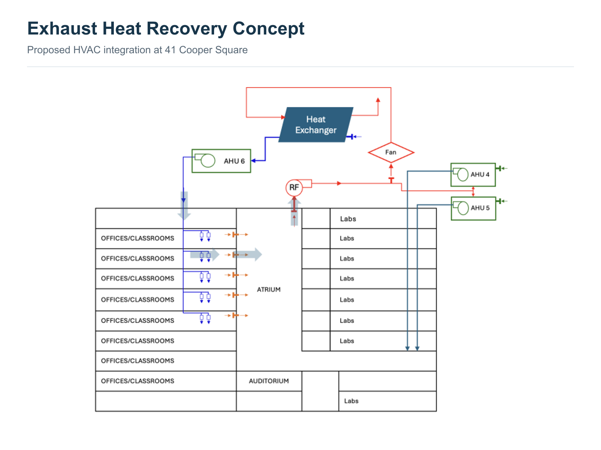
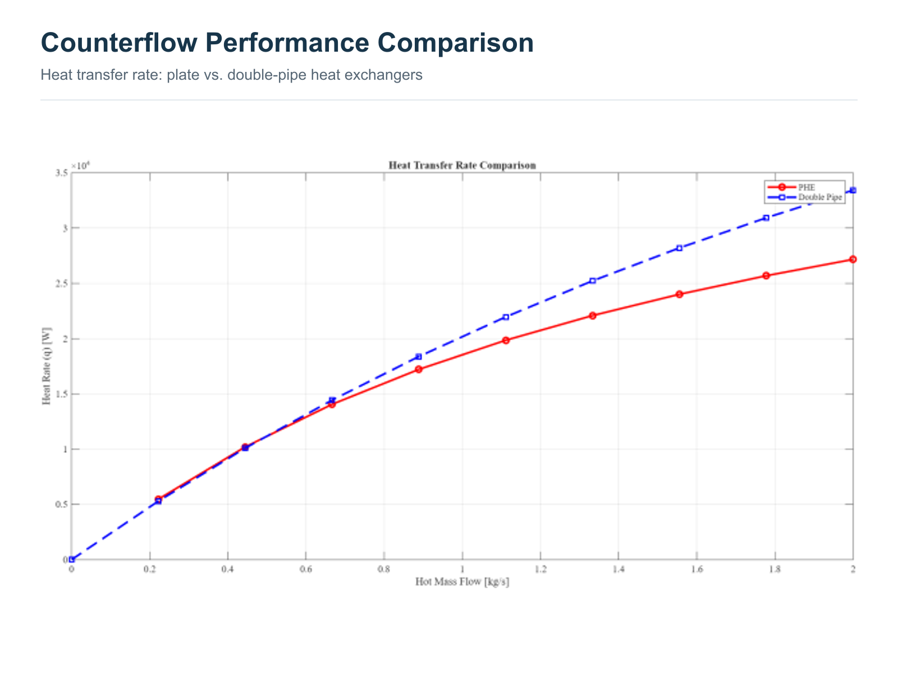

# HVAC Exhaust Heat Recovery
*Heat Transfer · Spring 2026*

  
  &nbsp;&nbsp;
  

**Description**  
Explored recovering heat from HVAC exhaust air to preheat incoming outdoor air at Cooper Union’s 41 Cooper Square. Compared plate and double-pipe heat exchangers to evaluate thermal performance, space requirements, and practical integration into the building’s HVAC system.

**What I Did**

- Proposed the exhaust heat recovery concept and helped guide the project, drawing on prior experience with Cooper Union’s building energy systems.
- Recommended evaluating a plate heat exchanger and helped establish design inputs, operating conditions, and modeling assumptions.
- Collaborated with teammates to derive energy balances and heat exchanger performance equations.
- Reviewed predicted heat transfer rates, outlet temperatures, and exchanger dimensions for physical plausibility and practical fit.

**Key Findings**

- Counterflow configurations provided higher modeled effectiveness than parallel-flow arrangements.
- The plate heat exchanger offered a more compact design than the double-pipe alternative, making it a promising candidate for space-constrained mechanical areas.
- Pressure drop and additional fan power were important considerations when assessing whether recovered heat would translate into net energy savings.

**Methods**

Energy balances, convection correlations, overall heat transfer coefficient estimation, effectiveness–NTU and LMTD analysis, parametric design comparisons, and engineering reasonableness checks.

#### 📄 [View Full Project Final Report](documents/S26-Heat.pdf)